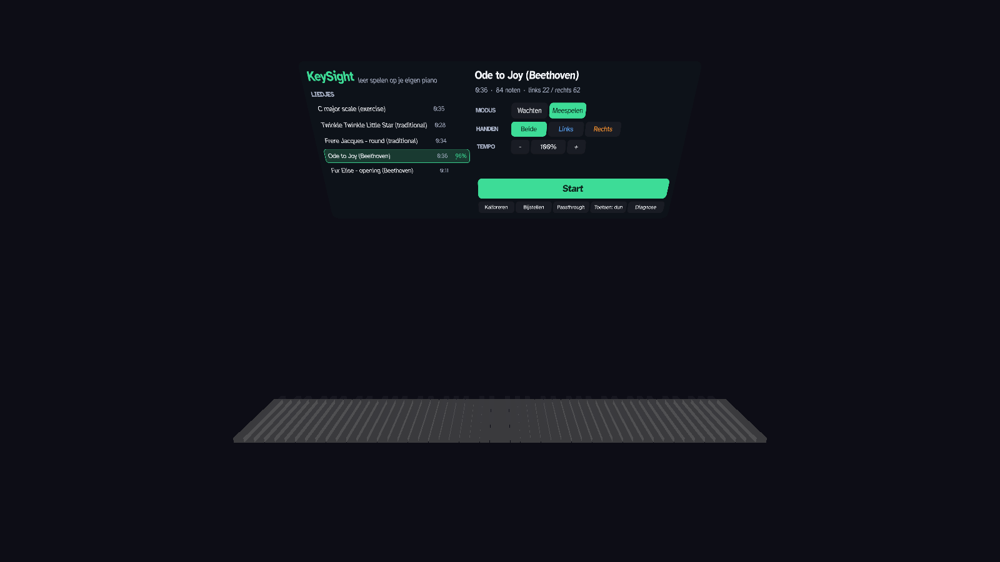
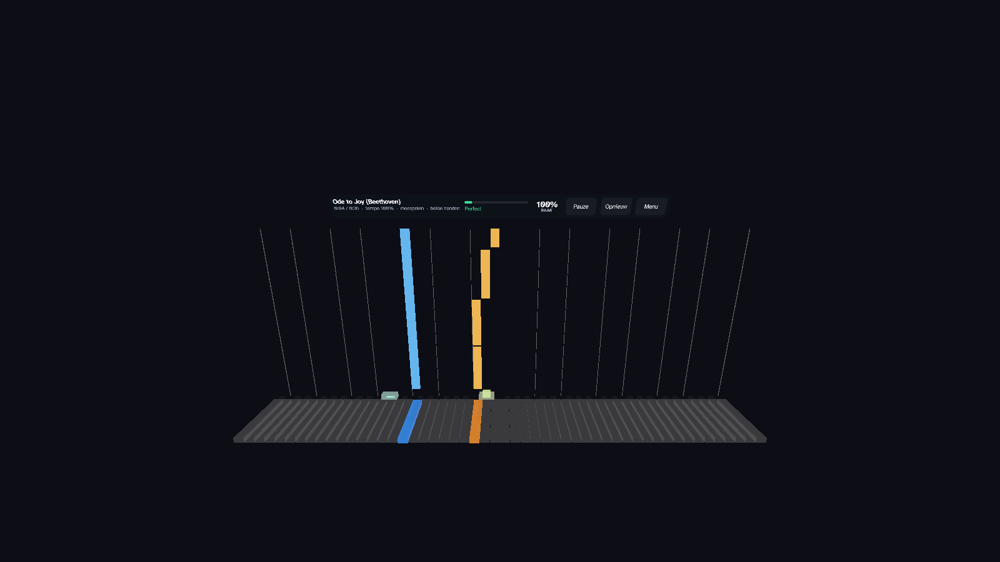
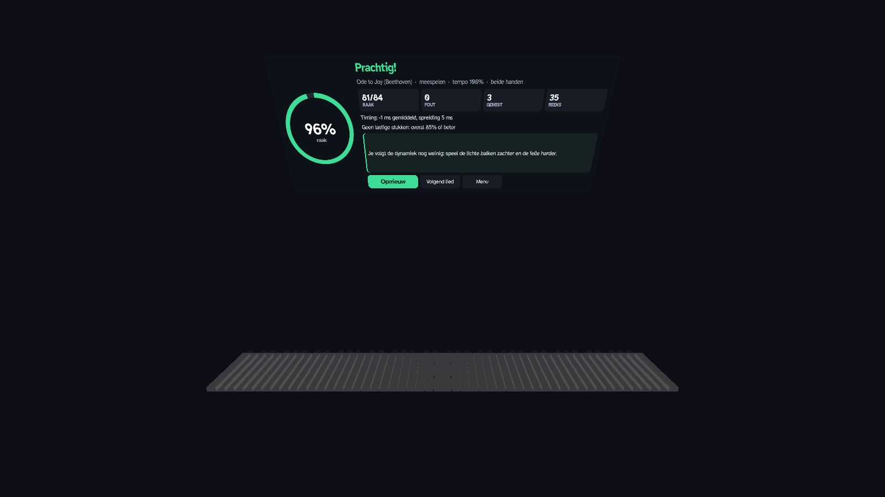

# KeySight

**Learn piano on your own piano, in mixed reality.** KeySight is an open-source app for the
Valve **Steam Frame** that runs natively on the headset (Godot 4.6, Linux ARM64, OpenXR). It
reads your digital piano over USB-MIDI and uses passthrough to drop falling notes straight onto
your real keys.



> **Status: early.** This is a hobby project that one person has tested on one setup
> (Steam Frame + Yamaha Clavinova CLP-230). Expect rough edges. Feedback and pull requests are
> very welcome.

## Features

- **Falling notes on your real keys**, in the style of Synthesia. A bar's bottom edge reaches
  the key exactly when you should play it, and its length is the note length. Right hand is
  orange, left hand is blue. The target key lights up just before the note arrives, then turns
  green when you hit it and red for a wrong key.
- **Wait mode**: the song pauses at every chord until you've played all of its notes. The clock
  starts on your first correct key.
- **Play-along mode** at 30-150 % tempo, with timing measured per note.
- **Practise one hand**: the other hand's notes are shown dimmed and aren't required.
- **Your own MIDI files** (`.mid`, format 0 and 1). Hands are taken from the two note tracks,
  or split at middle C if there's only one track.
- **Feedback**: hit/wrong/missed per note, plus a results card with accuracy, timing, the
  hardest passage and one practice tip. A full report covers early/late tendency, swapped
  keys, left vs right hand, black vs white keys, note release, dynamics and pedalling.
  Each song keeps your best score.
- **Calibration by touching keys**: press a few real keys with the controller tip, and since
  MIDI tells the app exactly which key it was, a least-squares fit lines up all 88 keys,
  including your piano's exact width. You can fine-tune the result with the thumbsticks.
- **Hands-free controls**: the middle (sostenuto) pedal starts and pauses. In the menu, the
  lowest A and B keys choose the previous or next song.

| Lesson | Results |
|---|---|
|  |  |

*Screenshots are from the desktop build. On the headset you see your room and piano behind the overlay.*

## Requirements

- Valve Steam Frame with **Developer Mode** enabled (to copy files over SSH)
- A digital piano or keyboard with **USB-MIDI** (class compliant), plus a cable to the headset's
  USB-C port. Some full-speed (USB 1.1) instruments only work through a small USB hub.
- To build: [Godot 4.6.2](https://godotengine.org/download/archive/4.6.2-stable/) with its export
  templates (they include `linux_release.arm64`)

## Build

```bash
cd step2-leren
godot --headless --path . --import
godot --headless --path . -- --selftest            # MIDI parsing, calibration maths, scoring
godot --path . -- --demo --song 3 --nowait           # desktop demo that plays by itself
godot --headless --path . --export-release "Steam Frame Arm64"
# -> step2-leren/build/frame-arm64/KeySight.arm64 (a single file with the game data inside)
```

## Install on the headset

1. On the Frame, turn on Developer Mode and set a password, then enable SSH.
2. Copy the binary and make it executable:
   ```bash
   ssh steamos@<headset-ip> "mkdir -p ~/keysight/songs"
   scp step2-leren/build/frame-arm64/KeySight.arm64 steamos@<headset-ip>:keysight/
   ssh steamos@<headset-ip> "chmod +x ~/keysight/KeySight.arm64"
   ```
3. Add it to Steam as a **non-Steam game**, for example with the SteamOS Devkit Client
   (Title Upload, start command `KeySight.arm64`), or from desktop mode. KeySight runs fine
   without a Steam Linux Runtime.
4. Plug the piano into the headset and start KeySight from your library.

**Your own songs:** put `.mid` files in a `songs/` folder next to `KeySight.arm64`, or in
`~/.local/share/KeySight/songs/`. Settings, calibration, scores and reports are stored in
`~/.local/share/KeySight/`.

## Controls

| Where | Action |
|---|---|
| Controller | Point at the panel and pull the trigger. The stick scrolls the song list. A/X start or pause, B/Y restart. |
| Piano only | Middle pedal starts, pauses or restarts. In the menu, the lowest A selects the previous song and the lowest B the next one. |
| Desktop (testing) | Mouse on the panel, Space, arrow keys (song/tempo), W, H, R, B (-5 s), K, P, Esc |

**Calibration:** press *Kalibreren*, hold a controller and use the yellow dot to press real keys one
at a time, near their front edge: first far left, then far right, then a few in the middle.
Then press *Klaar*. Use *Bijstellen* to nudge the keyboard with the sticks.

## Known limits

- **No hand tracking** on the Frame (yet), so you put the controllers down while you play.
- The display runs at **72 Hz** (the only rate offered to the app).
- Apps can't access the cameras, so calibration works by touching keys rather than by
  recognising the keyboard visually.
- **No sound and no MIDI output**: your piano makes the sound, and Godot has no MIDI out, so
  there's no accompaniment playback.
- The interface is currently in **Dutch**.

## Troubleshooting

- **No MIDI device / audio driver "Dummy"**: Godot only loads ALSA MIDI with a real audio driver.
  Add `--audio-driver ALSA` to the launch options.
- **Piano not detected**: check `cat /proc/asound/cards` over SSH. Full-speed USB instruments
  sometimes fail on the direct port; try a USB 2.0 hub (with power delivery so the headset
  keeps charging).
- **Keyboard overlay in the wrong place**: run *Kalibreren* again. The overlay is stored relative
  to the SteamVR play area, so recentring can move it.
- Logs: start the binary from a shell, or wrap it in a script that writes stdout to a file.

## Repository

| Folder | Contents |
|---|---|
| `step2-leren/` | **KeySight** (Godot project). Scripts are in `scripts/`; `tools/make_songs.py` generates the bundled songs. |
| `step1-midi-test/` | The first prototype: checks that USB-MIDI and passthrough work on the Frame, with a diagnostics panel. |
| `artwork/` | Steam library artwork plus the script that makes it |
| `docs/` | Screenshots |

## Roadmap

- English interface (with Dutch kept as an option)
- Hand tracking once the Frame offers it
- Loop a passage, metronome, count-in
- Sheet-music view, finger numbers
- Simpler installation (a ready-made release)

## Contributing

Issues and pull requests are welcome, especially reports from other pianos and keyboards: tell
us whether it was detected, and the output of `cat /proc/asound/cards`. Please run the self-test
before sending a PR. Songs you contribute must be public-domain compositions in your own
arrangement, or come with a licence that allows redistribution.

## Credits and licences

- Code: MIT, see [LICENSE](LICENSE). Built with the help of Claude (Anthropic).
- The falling-tile idea and per-hand colours were inspired by
  [piARno](https://github.com/piARn0/piARnoApp) (MIT). See [THIRD_PARTY.md](THIRD_PARTY.md).
- Font: Atkinson Hyperlegible (SIL Open Font License 1.1).
- Bundled songs: a C major scale, *Twinkle Twinkle Little Star* and *Frère Jacques*
  (traditional), Beethoven's *Ode to Joy* and the opening of *Für Elise*. All are public-domain
  compositions in new arrangements made for this project (MIT), generated by
  `step2-leren/tools/make_songs.py`.
- Artwork: AI-generated (ChatGPT) for this project.

## Nederlands

KeySight is een gratis app voor de Steam Frame om piano te leren op je eigen piano. Vallende
noten komen via passthrough op je echte toetsen, met een wachtmodus, tempo en oefenen per
hand. Je kunt eigen MIDI-bestanden gebruiken, je krijgt feedback, en je kalibreert door een
paar toetsen aan te raken. De interface is in het Nederlands. Nog vroeg, getest op één
Yamaha CLP-230.
